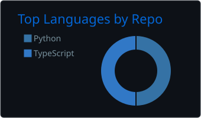
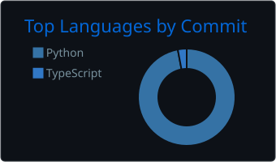

<p align="center">
  
</p>

<p align="center">
  
</p>

> independent dev making discord bots, selfbots and web apps. i like bots with personality and sites that dont look like templates.

```bash
>> neofetch
```



```yaml
name     : roadsman
role     : independent dev
building : discord bots, selfbots, web apps
langs    : python, typescript, java
stack    : next.js, fastapi, postgres, supabase
infra    : vps, pm2
now      :
  - writing bots with actual personality
  - making apis
  - fixing things i broke >.<
```

<br clear="left" />

### skills & tools


---

### how to reach me

* discord: [dm me](https://discord.com/users/1164952223873257515)

<p align="center">
  
</p>

### stats

<p align="center">
  
  
</p>

<p align="center">
  
</p>

### contributions

<p align="center">
  
</p>

<p align="center">
  
  
</p>
